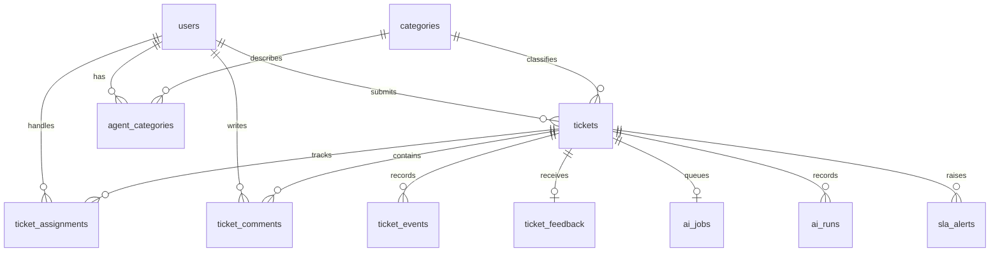

# Relay Support

Relay Support is an AI-assisted customer support and complaint management system. Customers submit and track complaints, agents handle assigned tickets, and admins manage assignments, service deadlines, and support reports.

## What the app does

| Role | Features |
| --- | --- |
| **Customer** | Register, submit complaints, track their own tickets, read and post replies, close resolved tickets, leave feedback, and delete their own complaints |
| **Agent** | Work on assigned tickets, change priority and status, post public replies or internal notes, and review AI suggestions |
| **Admin** | View all tickets, assign agents, manage categories and agent skills, review SLA alerts, and export analytics as CSV or JSON |

## Ticket workflow

1. A customer submits a complaint and receives a unique ticket number.
2. The ticket starts as **Open** with **Medium** priority. A background job checks its category, sentiment, and priority.
3. The admin assigns the ticket. The app suggests agents based on category skills and available capacity.
4. The agent investigates, replies, and marks the ticket as **Resolved**.
5. The customer closes the ticket and can leave a rating.

## AI features

The Spring Boot backend supports complaint classification, sentiment analysis, priority prediction, resolution suggestions, and customer reply drafts in empathetic, formal, or concise tones.

Set `LLM_API_KEY` to enable an OpenAI-compatible provider. The backend labels successful model results **MODEL**. When the provider is disabled or a request fails, it uses built-in rules, category playbooks, or response templates and labels the result **FALLBACK**. Agents review and edit reply drafts before sending them.

## Tech stack

| Layer | Technologies |
| --- | --- |
| Frontend | React, JavaScript, JSX, Vite, React Router, CSS, Lucide |
| Backend | Java targeting 21, Spring Boot, Spring MVC, Spring Data JPA, Hibernate, Spring JDBC |
| Security | Spring Security, BCrypt password hashes, session cookies, CSRF protection |
| Database | MySQL 8 |
| AI | OpenAI-compatible API through Spring `RestClient` |
| Build tools | Maven Wrapper and npm |

## Project structure

```text
Customer-Support/
├── backend/     # Spring Boot application and REST APIs
├── database/    # MySQL schema and starter categories
└── frontend/    # React application
```

## Run locally on Windows

**Prerequisites**  
JDK 21 or newer, Node.js 22.12 or newer, and MySQL Server 8.

### 1. Initialize MySQL

In MySQL Workbench, run `database/01_schema.sql` and then `database/02_seed_categories.sql`. Use a fresh `smart_support` schema for first-time setup.

On the MySQL admin connection, create the backend login. **Replace `CHOOSE_A_LOCAL_DB_PASSWORD` with your own password before running this SQL.**

```sql
CREATE USER IF NOT EXISTS 'support_app'@'localhost'
IDENTIFIED BY 'CHOOSE_A_LOCAL_DB_PASSWORD';

GRANT SELECT, INSERT, UPDATE ON smart_support.* TO 'support_app'@'localhost';

GRANT DELETE ON smart_support.agent_categories TO 'support_app'@'localhost';
GRANT DELETE ON smart_support.tickets TO 'support_app'@'localhost';
GRANT DELETE ON smart_support.ticket_assignments TO 'support_app'@'localhost';
GRANT DELETE ON smart_support.ticket_comments TO 'support_app'@'localhost';
GRANT DELETE ON smart_support.ticket_events TO 'support_app'@'localhost';
GRANT DELETE ON smart_support.ticket_feedback TO 'support_app'@'localhost';
GRANT DELETE ON smart_support.ai_jobs TO 'support_app'@'localhost';
GRANT DELETE ON smart_support.ai_runs TO 'support_app'@'localhost';
GRANT DELETE ON smart_support.sla_alerts TO 'support_app'@'localhost';
```

### 2. Start Spring Boot

From the project root, open PowerShell and run:

```powershell
cd backend
$env:DB_PASSWORD = [System.Net.NetworkCredential]::new('', (Read-Host 'MySQL password for support_app' -AsSecureString)).Password
.\mvnw.cmd spring-boot:run
```

The API runs at `http://127.0.0.1:8080/api/v1`. Open `/api/v1/categories` to check the database connection.

For a fresh local demo, set `DEMO_PASSWORD` in the same terminal **before starting Spring Boot**. Choose a password of at least 12 characters. This creates sample tickets and demo accounts, including `admin@example.test`, `agent@example.test`, and `customer@example.test`. The demo accounts use the password you choose.

### 3. Start React

Open a second PowerShell terminal at the project root:

```powershell
cd frontend
npm.cmd install
npm.cmd run dev
```

Open `http://127.0.0.1:5173/`. Vite forwards `/api` requests to Spring Boot during local development.

## Database design

The database has **11 tables**. The five core tables are `users`, `categories`, `tickets`, `ticket_assignments`, and `ticket_comments`. The supporting tables are `agent_categories`, `ticket_events`, `ticket_feedback`, `ai_jobs`, `ai_runs`, and `sla_alerts`.



## Technical highlights

- **Access control** enforces who can view and update each ticket. Customer deletion checks ownership and removes linked records in one transaction.
- **Idempotency keys** let a customer retry a complaint submission without creating a duplicate.
- **Ticket versions** help prevent stale updates when multiple people work on the same ticket.
- **SLA alerts** flag urgent tickets and approaching or missed deadlines. The dashboard calculates on-time resolution as the percentage of resolved tickets that met their deadline in the selected period.
- **Analytics exports** provide the dashboard data in CSV or JSON.
